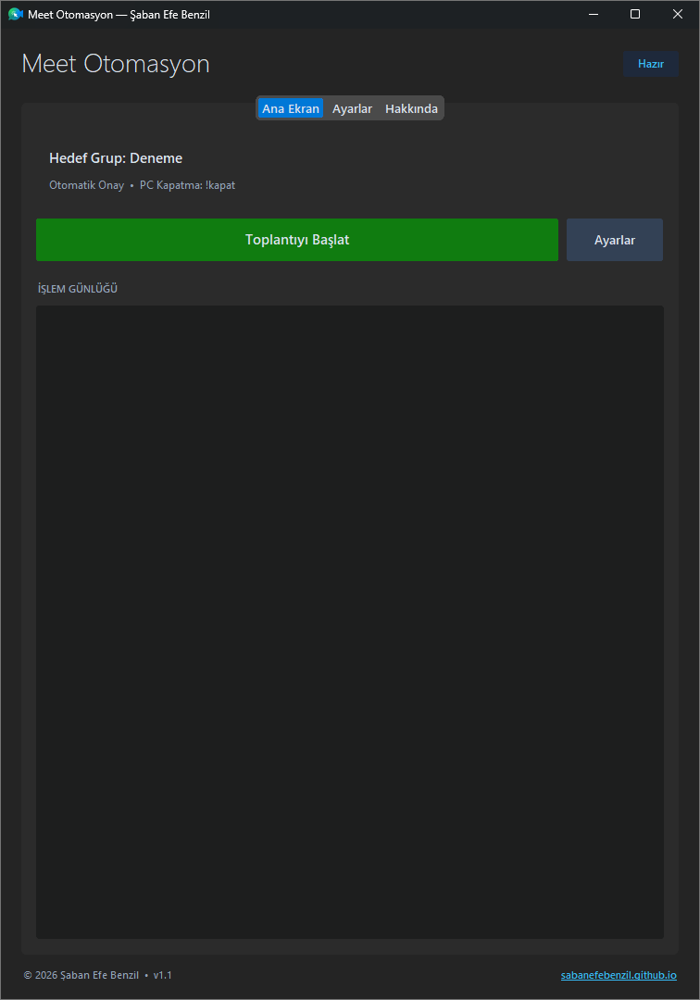
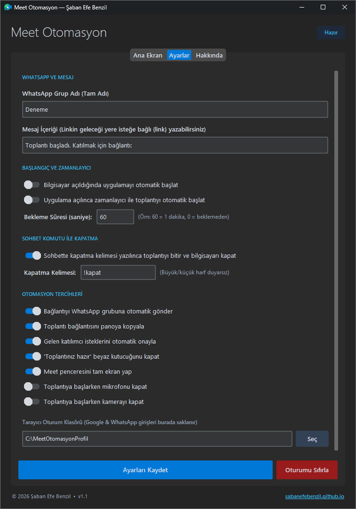
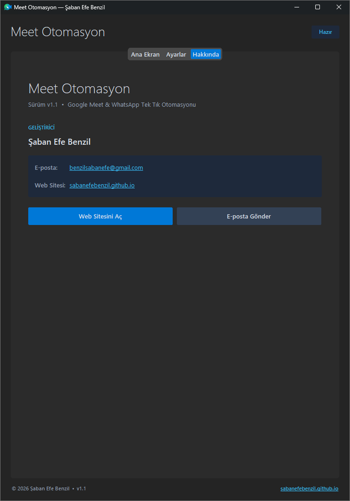

<div align="center">
  
  <h1>Meet Otomasyon</h1>
  <p>
    <strong>Tek tıkla Google Meet toplantısı başlatan, bağlantıyı WhatsApp grubunda paylaşan, katılımcıları otomatik onaylayan ve sohbet komutuyla oturumu sonlandırabilen Windows masaüstü uygulaması.</strong>
  </p>

  <p>
    
    
    
    
  </p>

  <p>
    <a href="https://github.com/sabanefebenzil/meet-otomasyon/releases/latest"><strong>Son Sürümü İndir (.exe)</strong></a>
    &nbsp;•&nbsp;
    <a href="#özellikler">Özellikler</a>
    &nbsp;•&nbsp;
    <a href="#ekran-görüntüleri">Ekran Görüntüleri</a>
    &nbsp;•&nbsp;
    <a href="#kurulum-ve-kullanım">Kurulum</a>
    &nbsp;•&nbsp;
    <a href="#kaynak-koddan-derleme">Derleme</a>
  </p>
</div>

---

## Özellikler

- **Tek Tıkla Toplantı & Paylaşım:** Yeni Google Meet bağlantısı oluşturur, bağlantıyı Windows panosuna kopyalar ve WhatsApp Web üzerinden belirlediğiniz gruba özelleştirilebilir mesaj şablonuyla gönderir.
- **Otomatik Katılımcı Onayı:** Toplantı açık kaldığı sürece sağ üstte beliren *"davetli bekliyor"* bildirimlerini algılar, katılımcıları otomatik kabul eder ve ardından yan paneli geri kapatır.
- **Temiz Tam Ekran Deneyimi:** *"Toplantınız hazır"* bilgi kutucuğunu kapatır, isteğe bağlı mikrofon/kamerayı sessize alır ve tarayıcıyı uyarı şeridi olmadan doğrudan tam ekran yapar.
- **Kalıcı Oturum & Tek Seferlik Ayar:** Google ve WhatsApp Web girişleri yerel tarayıcı profilinde, uygulama tercihleri ise `ayarlar.json` dosyasında saklanır.
- **Windows Başlangıcı & Zamanlayıcı:** İsteğe bağlı olarak bilgisayar açıldığında otomatik başlar ve belirlediğiniz bekleme süresi (örn. 60 sn) sonunda toplantıyı kendiliğinden açar.
- **Sohbet Komutu ile PC Kapatma:** Toplantı sohbetine belirlediğiniz kelime (varsayılan `!kapat`) yazıldığında görüşmeyi herkes için sonlandırır, tarayıcıyı güvenli şekilde kapatır ve bilgisayarı kapatır.
- **Tarayıcı Bağımsızlığı:** Kurulu olan Google Chrome, Microsoft Edge veya Chromium tarayıcılarından uygun olanı otomatik seçer.

---

## Ekran Görüntüleri

<table>
  <tr>
    <td align="center" width="50%">
      
      <br />
      <sub><strong>Ana Ekran</strong> — Özet kartı, geri sayım ve canlı işlem günlüğü</sub>
    </td>
    <td align="center" width="50%">
      
      <br />
      <sub><strong>Ayarlar</strong> — Grup adı, zamanlayıcı ve sohbet kapatma komutu</sub>
    </td>
  </tr>
  <tr>
    <td align="center" width="50%">
      
      <br />
      <sub><strong>Hakkında</strong> — Sürüm ve geliştirici iletişim bağlantıları</sub>
    </td>
    <td align="center" width="50%">
      
      <br />
      <sub><strong>Otomasyon Aktif</strong> — Bildirim şeritsiz tam ekran Google Meet</sub>
    </td>
  </tr>
</table>

---

## Kurulum ve Kullanım

### Seçenek 1: Hazır Uygulama (Önerilen — Python Gerektirmez)

1. Sağ menüdeki [**Releases**](https://github.com/sabanefebenzil/meet-otomasyon/releases/latest) sayfasından **`MeetOtomasyon.exe`** dosyasını indirin.
2. Dosyayı kendi oluşturduğunuz bir klasöre (örn. `C:\MeetOtomasyon`) taşıyın ve çalıştırın.
   > *Dijital imza bulunmadığı için Windows SmartScreen uyarısı çıkarsa **Ek bilgi → Yine de çalıştır** seçeneğini kullanın.*
3. İlk açılışta gelen **Ayarlar** sekmesinden WhatsApp grup adınızı, mesaj şablonunuzu ve otomasyon tercihlerinizi seçip **Ayarları Kaydet**'e basın.
4. İlk toplantı başlatıldığında açılan tarayıcıda Google hesabınıza ve WhatsApp Web'e bir kez giriş yapın. Sonraki tüm kullanımlarda oturum otomatik hatırlanır.

---

## Ayarlar Özeti

| Ayar | Varsayılan | Açıklama |
| :--- | :--- | :--- |
| **WhatsApp Grup Adı** | *(Boş)* | Bağlantının gönderileceği grubun tam adı |
| **Mesaj İçeriği** | `Toplantı başladı...` | Link konumu için isteğe bağlı `{link}` yer tutucusu desteklenir |
| **Windows Başlangıcı** | Kapalı | Bilgisayar açıldığında uygulamayı otomatik başlatır |
| **Başlatma Zamanlayıcısı** | 60 saniye | Uygulama açıldıktan sonra toplantının otomatik başlama süresi |
| **Otomatik Katılımcı Onayı** | Açık | Bekleyen tüm davetlileri otomatik kabul eder |
| **Sohbet Kapatma Komutu** | `!kapat` | Sohbete yazıldığında toplantıyı sonlandırıp bilgisayarı kapatır |
| **Tam Ekran & Bilgi Kutusu** | Açık | Bilgi kartını kapatır ve Meet penceresini tam ekran yapar |

> **İpucu:** Sohbet kapatma komutu yanlışlıkla tetiklenirse, 5 saniye içinde `Win + R` penceresine `shutdown /a` yazarak kapatma işlemini iptal edebilirsiniz.

---

## Kaynak Koddan Derleme

Kodu kendiniz çalıştırmak veya kendi `.exe` dosyanızı üretmek için Windows bilgisayarınızda Python 3.10+ yüklü olması yeterlidir:

```bat
git clone [https://github.com/sabanefebenzil/meet-otomasyon.git](https://github.com/sabanefebenzil/meet-otomasyon.git)
cd meet-otomasyon
```

Ardından klasördeki **`EXE_Olustur.bat`** dosyasına çift tıklayın. Betik gerekli tüm paketleri (`playwright`, `customtkinter`, `pyinstaller`, `pillow`) otomatik kurar, `icon.png` dosyasını şeffaf `.ico` formatına çevirir ve bağımsız **`MeetOtomasyon.exe`** dosyasını oluşturur.

---

## Dosya Yapısı

```text
meet-otomasyon/
├── screenshots/         # README galerisinde gösterilen ekran görüntüleri
│   ├── ana-ekran.png
│   ├── ayarlar.png
│   ├── hakkinda.png
│   └── meet-tam-ekran.png
├── meet_otomasyon.pyw   # Ana uygulama ve Playwright otomasyon motoru
├── EXE_Olustur.bat      # Tek tıkla bağımlılık kurulumu ve PyInstaller derleyici
├── version_info.txt     # Windows EXE sürüm ve geliştirici meta verileri
├── icon.png             # Uygulama ikonu kaynağı
├── README.md            # Proje dokümantasyonu
└── .gitignore           # Kişisel ayarlar ve derleme çıktılarını hariç tutar
```

---

## Geliştirici

**Şaban Efe Benzil**

- Web: [sabanefebenzil.github.io](https://sabanefebenzil.github.io)
- E-posta: [benzilsabanefe@gmail.com](mailto:benzilsabanefe@gmail.com)
- GitHub: [@sabanefebenzil](https://github.com/sabanefebenzil)